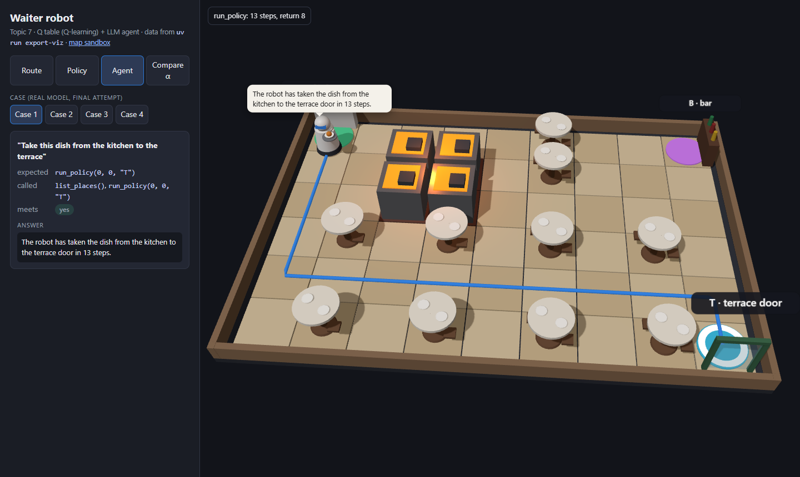
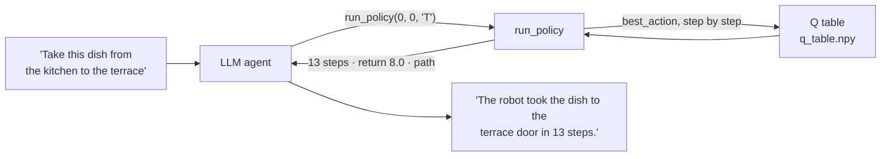
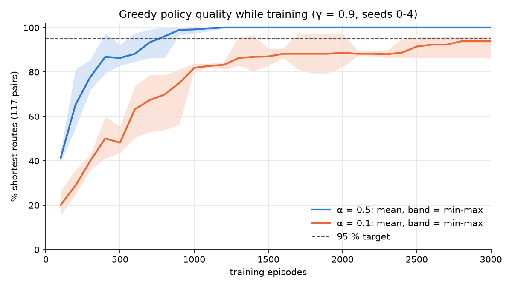
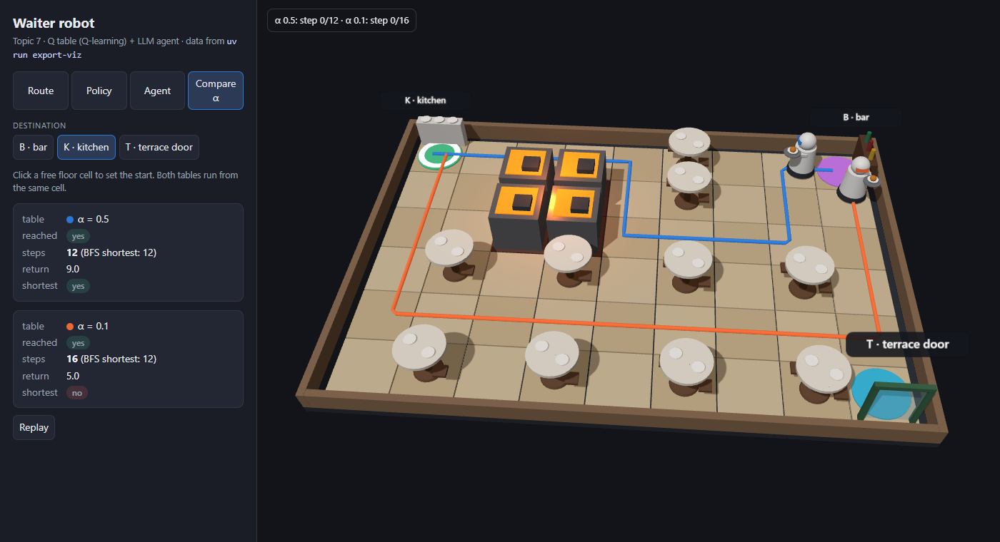
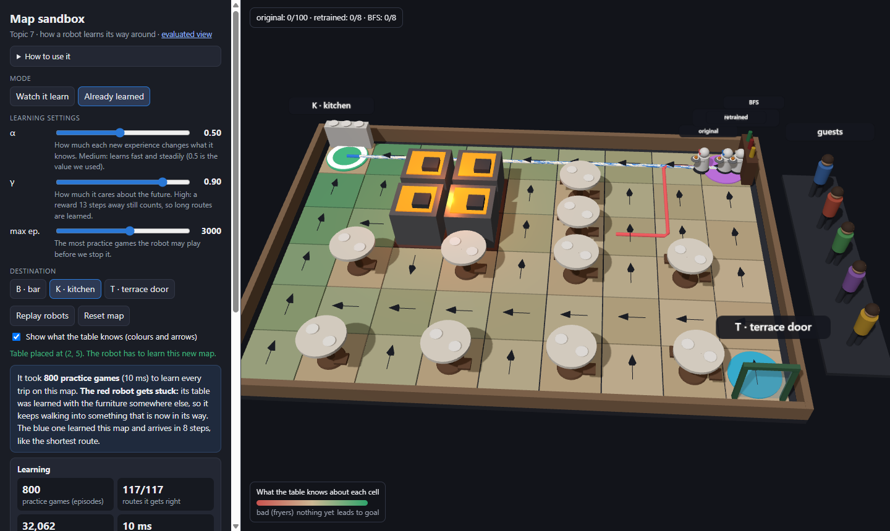

# Waiter robot

**A robot waiter that learns its way around a restaurant, and an AI assistant that understands what you ask it.**




---

## In one minute

You type a request such as *"Take this dish from the kitchen to the terrace"*. Two pieces work together:

| Piece | What it does | What it does **not** do |
|---|---|---|
| **LLM agent** (Ollama, `qwen2.5:14b`) | Understands the request, finds the origin and the destination, calls the tools and writes the answer | Never computes routes or invents numbers |
| **Q table** (Q-learning) | Knows the best move in every cell, learned by trial and error | Does not understand language |



The Q table is trained **once, beforehand**, in a Gymnasium environment; the agent only reads it.

---

## The restaurant

```
K....#..B      K  kitchen (0, 0)       #  table: the robot cannot go through
..~~.#...      B  bar (0, 8)           ~  fryers: −50 and the trip ends
..~~.....      T  terrace door (5, 8)  .  free floor
.#.#.#.#.
.........      6 × 9 cells · 3 destinations · 162 states
.#.#.#.#T
```

**Rewards:** −1 per step (so short routes are best) · +20 on arriving · −50 in the fryers.
**Shortest routes:** kitchen ↔ terrace door 13 steps · kitchen ↔ bar 12 · bar ↔ terrace door 5.

---

## Results

| What | Result |
|---|---|
| Q table (α = 0.5, γ = 0.9, 3000 episodes, seed 0) | **117 / 117** trips by the shortest route (95 % required) |
| Learning rate, 5 seeds | α = 0.5: every seed at 100 % from ~1200 episodes · α = 0.1: 93.8 % mean at 3000 |
| Agent with the real model | **4 / 4** cases (after 6 attempts, see [`results/cases.md`](results/cases.md)) |
| Tests | **52 passed**, with no network, no Ollama and no token |

<table>
<tr>
<td width="50%"></td>
<td width="50%"></td>
</tr>
<tr>
<td><b>Learning curves.</b> α = 0.5 learns much faster; the band shows the spread over 5 seeds.</td>
<td><b>Same trip, two tables.</b> Bar → kitchen: α = 0.5 takes 12 steps (blue), α = 0.1 a 16-step detour (orange).</td>
</tr>
</table>

The four cases the agent is checked on:

| # | Request | Expected | Meets |
|---|---|---|---|
| 1 | *Take this dish from the kitchen to the terrace* | `run_policy(0, 0, "T")` → 13 steps | yes |
| 2 | *The robot is at the bar; send it back to the kitchen* | `run_policy(0, 8, "K")` → 12 steps | yes |
| 3 | *Take the dish from the kitchen to the storeroom* | asks which place, no `run_policy` | yes |
| 4 | *What wine do you recommend?* | "not my job", no `run_policy` | yes |

---

## How to run

You need [uv](https://docs.astral.sh/uv/). Run every command **from the project root**, in this order:

```bash
uv sync                      # 1. install Python 3.14 and the dependencies
uv run pytest                # 2. run the 52 tests (no network, no Ollama needed)
uv run train                 # 3. train the Q table -> q_table.npy
uv run evaluate              # 4. check it: "shortest routes: 117/117 (100.0 %)"
uv run experiment            # 5. alpha 0.5 vs 0.1, seed 0 -> results/experiment.png
uv run experiment --seeds 5  # 6. the same with seeds 0-4 -> results/experiment_seeds.png
```

### Talk to the robot

Needs [Ollama](https://ollama.com) running with the model downloaded:

```bash
ollama pull qwen2.5:14b
uv run agent "Take this dish from the kitchen to the terrace"
```

It prints the whole conversation: your request, every tool call, what each tool returned and the final answer.

### See it in 3D (extra)

```bash
uv run export-viz   # writes viz/data.js (q_table.npy is only read)
```

Then open the pages with a double click (they load Three.js from a CDN, so they need internet):

| Page | What you can do |
|---|---|
| [`viz/index.html`](viz/index.html) | **The evaluated system.** Four modes: *Route* (click a cell, watch the robot go), *Policy* (an arrow per cell), *Agent* (the 4 real cases replayed), *Compare α* (two robots side by side) |
| [`viz/sandbox.html`](viz/sandbox.html) | **The map sandbox.** Drag tables, drop guests on the floor, change α and γ with sliders, and *Watch it learn* |



In the sandbox, moving a table shows the main limit of Q-learning: **the table only knows the map it was trained on.** The original table (red) gets stuck, a table retrained in the browser (blue) finds the new route, and BFS (white) gives the shortest route for reference. The environment and training are reimplemented in JavaScript for this page (`viz/sandbox-core.js`); `data/map.txt` and `q_table.npy` never change. Its tests need [Node.js](https://nodejs.org) and are skipped without it. `viz/sandbox.html#move-table` opens this example directly.

---

## Project structure

```
waiter-robot/
├── CLAUDE.md               the specification (contracts with exact values)
├── .claude/
│   ├── settings.json       what Claude Code may and may not do (ask / deny)
│   └── commands/           one command per milestone (/setup, /build-env, /train, …)
├── worklog.md              what was asked, accepted and rejected in each milestone
├── data/map.txt            the restaurant map
├── src/waiter_robot/
│   ├── env.py              Gymnasium environment WaiterRobot-v0
│   ├── q_table.py          the Q table of Session 5
│   ├── train.py            random training -> q_table.npy
│   ├── evaluate.py         117 pairs against breadth-first search
│   ├── experiment.py       learning-rate experiment (1 or 5 seeds)
│   ├── tools.py            list_places() and run_policy()
│   ├── agent.py            the LLM agent (LangChain + Ollama)
│   └── export_viz.py       data for the 3D pages
├── tests/                  52 tests, with ScriptedModel as the LLM double
├── q_table.npy             the trained table (162 × 4)
├── results/                plots, agent cases and real traces
├── viz/                    the two 3D pages
└── informe.pdf             the report
```

## How it was built

The student wrote the specification (`CLAUDE.md`), the permissions and one command per milestone; **Claude Code wrote the code**, one milestone at a time, and every change was reviewed against the specification before accepting it. [`worklog.md`](worklog.md) records each milestone, from H0 (project setup) to H12 (sandbox extras): what was accepted, what was rejected and why, and the check that closed it.
