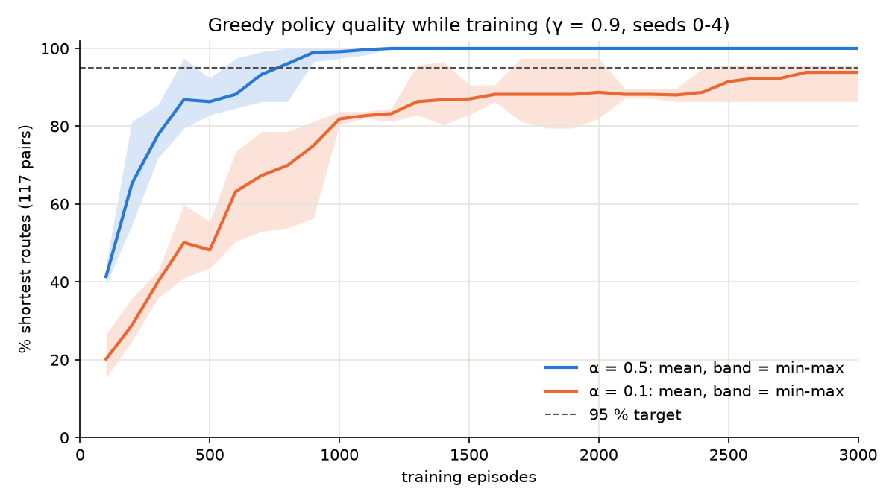
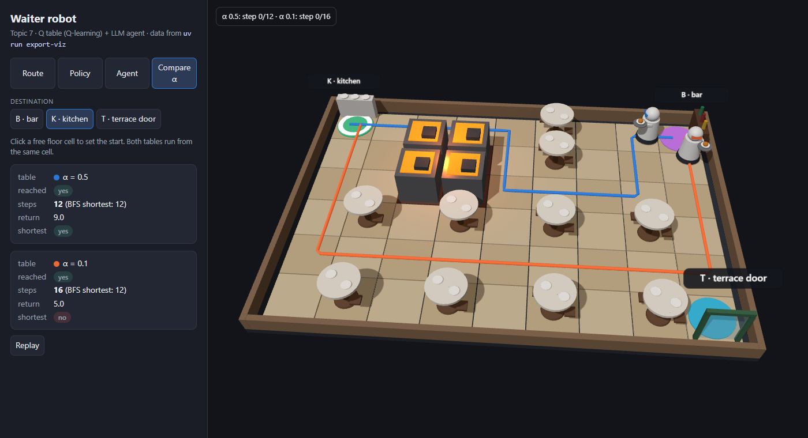

# Waiter robot: a Q table that decides and an LLM that explains

**Lab Assignment II · Topic 7 (waiter robot in a restaurant)** · Artificial Intelligence, Grado en Ingeniería Informática, CUNEF · Alberto Olmos (Godalberto10)

The project builds an agent for a restaurant robot that carries dishes and drinks between the kitchen (K), the bar (B) and the terrace door (T). A Q table, trained once in a Gymnasium environment, decides how to move from cell to cell; an LLM agent reads the request, calls the table through two tools and answers with the figures they return. The specification (`CLAUDE.md`), the permissions (`.claude/settings.json`) and one command per milestone (`.claude/commands/`) were written first; Claude Code wrote the code milestone by milestone, every diff was reviewed against the specification, and `worklog.md` records what was accepted, rejected and corrected in each one.

## 1. Problem and environment

The map (`data/map.txt`) has 6 rows × 9 columns: 40 free cells, 10 tables (`#`, obstacles) and 4 cells of the fryer area (`~`, danger). The kitchen is at (0, 0), the bar at (0, 8) and the terrace door at (5, 8); the shortest routes are K↔T 13 steps, K↔B 12 and B↔T 5. The K→T route is the demanding one: the shortest paths run close to the fryers.

```
K....#..B
..~~.#...
..~~.....
.#.#.#.#.
.........
.#.#.#.#T
```

`WaiterRobotEnv` is a subclass of `gymnasium.Env`, registered as `WaiterRobot-v0` with `max_episode_steps=100`:

- **State:** destination · 54 + row · 9 + col, with destinations numbered alphabetically (B = 0, K = 1, T = 2), so `observation_space = Discrete(162)`. The destination must be part of the state: in the same cell, the best action depends on where the robot is going.
- **Rewards:** −1 per step, so that the shortest route is the best one; +20 on reaching the destination; −50 on entering the fryer area. The last two end the episode (`terminated`).
- **Decisions not fixed by the assignment:** the cell of another place is a normal free cell (the robot may pass by the bar on its way to the terrace); `step` after the end of an episode raises `RuntimeError`; the class never truncates, the 100-step limit comes only from the `TimeLimit` that `make` adds; empty `options` in `reset` behave like no options, because `check_env` calls `reset(options={})`.

`check_env` passes with no warnings, and there is one test per `step` rule with the exact tuple it must return; for example, from (0, 2) heading to T, moving down gives `(119, -50.0, True, False, {})`.

## 2. Training and evaluation

The Q table is the `QTable` of Session 5, unchanged. Training follows `cliff_walking.py`: random actions with `env.action_space.sample()` and `update(s, a, r, s2, terminated)` after every step, with α = 0.5, γ = 0.9, 3000 episodes and seed 0. `update` receives `terminated`, never `truncated`: cutting an episode at 100 steps does not mean the future is worth 0. The table is saved with `np.save` in `q_table.npy` (162 × 4) and is never trained again; a test checks that two trainings with the same seed give the same table.

The evaluation takes every (origin, destination) pair, 39 free origins × 3 destinations = 117 pairs, and follows `best_action` from the origin. A pair counts as a shortest route if the robot reaches the destination in exactly the number of steps that breadth-first search gives on the map. The result is **117/117 (100 %)**, above the required 95 % (112 pairs). The evaluation never calls `update`, and a test checks that the table is unchanged.

## 3. Experiment: learning rate

Both configurations use γ = 0.9 and train for 3000 episodes; after each block of 100 episodes the 117 pairs are evaluated. The experiment was run with five seeds (0–4): the figure shows, per α, the mean and a band from the minimum to the maximum over the seeds (`uv run experiment --seeds 5`).



- **α = 0.5:** the mean passes 95 % at 800 episodes and every seed is at 100 % from 1200 episodes on.
- **α = 0.1:** at 3000 episodes the mean is 93.8 % (minimum 86.3 %, maximum 95.7 %); the mean never reaches 95 %. Seed 0, the one used for `q_table.npy`, is the worst of the five: its curve (`results/experiment.png`) ends at 86.3 % after a dip to 81 % at 1700 episodes, which the other seeds do not show.

**Reading.** The rewards are deterministic, so a high learning rate has no noise to average out and only speeds learning up. Each update moves Q(s, a) a fraction α of the way to the target: with α = 0.5 the +20 of the destination travels back along a route in a few visits, while with α = 0.1 it needs many more, so cells far from the destination keep values that do not yet rank the actions correctly. The 16 pairs that α = 0.1 still gets wrong with seed 0 confirm it: in all of them the robot **does** arrive, but with 2–4 extra steps, and 14 of the 16 head to the kitchen. From the bar, for instance, the policy goes down to row 4, crosses it and climbs column 0 (16 steps) instead of the 12-step route that goes round the table at (0, 5) through row 2 and back along row 0, next to the fryers: the values along the shorter route have not yet overtaken those of the detour. The wider band of α = 0.1 says the same: which detours remain depends on the random actions of each seed. The dip of seed 0 at 1700 episodes has the same cause: when two actions have almost the same value, one update can swap the best action in a cell and break every route that crosses it.

**3D view.** The detour can be watched in the 3D visualization (extra milestone H8: `uv run export-viz`, then open `viz/index.html`), which draws the routes of both seed-0 tables with the same code as `run_policy`. Below, both robots start at the bar heading to the kitchen: α = 0.5 (blue) takes the 12-step route; α = 0.1 (orange) goes down the right side, crosses row 4 and climbs column 0, 16 steps. A second page, `viz/sandbox.html` (H9), lets tables and guests be moved: the original table then gets stuck or takes detours, while a table retrained in the browser follows the new shortest route, as the session's "A\* or Q-learning" slide predicts. Its sliders for α and γ and its "Watch it learn" mode (H12) show the same effect as the experiment: the coloured floor fills in from the destination much faster with α = 0.5 than with α = 0.1.



## 4. LLM agent

**Tools.** `list_places()` returns the three places with letter, name and cell. `run_policy(start_row, start_col, destination)` validates the request before moving (off the map, a table, the fryer area, a destination that is not a place letter, or start equal to destination raise `ValueError`), places the robot with `reset(options=...)`, applies `best_action` until it arrives, enters danger or takes 100 steps, and returns `{reached, steps, return, path}`. `run_policy(0, 0, "T")` gives 13 steps and return 8.0 (12 steps at −1 and +20 on arrival). In the agent, a wrapper turns a `ValueError` into the text `"error: <cause>"`, so the model can explain it and the program does not stop; the description the model reads says so.

**Agent.** LangChain `create_agent` with a local model through Ollama (`qwen2.5:14b`, `temperature=0`). The system prompt is an ordered procedure: (1) decide whether the request is about moving the robot, and if not say so and stop; (2) map the place names with the list of places; (3) ask if the origin is missing or a place does not exist; (4) call `run_policy` and answer only with its steps and return; (5) explain any `"error: ..."` text. Two decisions are made by the code, not by the model (milestone H10): the code calls `list_places()` itself and appends the places to the system prompt, and if an answer names a tool as text instead of calling it, the agent asks once more ("Call the tool; do not describe the steps."). The 49 tests run with no network: the agent tests use `ScriptedModel`, a fake chat model with fixed replies, which checks the agent's code (the figures come from the real `run_policy`, an error comes back as text, the retry fires once and only when a tool is named) but not the model's judgement.

**Four cases with the real model** (final attempt 6):

| # | Request | Expected tools | Tools called | Answer | Meets? |
|---|---|---|---|---|---|
| 1 | "Take this dish from the kitchen to the terrace" | `run_policy(0, 0, "T")` | `list_places`, `run_policy(0, 0, "T")` | 13 steps | yes |
| 2 | "The robot is at the bar; send it back to the kitchen" | `run_policy(0, 8, "K")` | `run_policy(0, 8, "K")` | 12 steps, return 9.0 | yes |
| 3 | "Take the dish from the kitchen to the storeroom" | no `run_policy` | none | the storeroom is not a place; asks which of the three | yes |
| 4 | "What wine do you recommend?" | none | none | the robot only carries things between the three places | yes |

**Trace 1** (case 2, condensed; full output in `results/traces/case2.txt`):

```
Human:  The robot is at the bar; send it back to the kitchen
AI:     tool call run_policy(start_row=0, start_col=8, destination="K")
Tool:   {"reached": true, "steps": 12, "return": 9.0,
         "path": [[0,8],[0,7],[1,7],[2,7],[2,6],[2,5],[2,4],[1,4],[0,4],[0,3],[0,2],[0,1],[0,0]]}
AI:     The robot has returned to the kitchen. It took 12 steps and received a total reward
        of 9.0. The path it followed was: bar → [0, 7] → [1, 7] → … → [0, 1] → kitchen.
```

**Trace 2** (case 4, full output from `results/traces/case4.txt`):

```
Human:  What wine do you recommend?
AI:     The robot only carries dishes and drinks between the kitchen, the bar, and the
        terrace door. It cannot recommend wine or perform tasks unrelated to carrying items.
```

Trace 1 is the case that failed before attempt 6: with the places already in the prompt, the model goes straight to `run_policy` with the bar's cell and answers with its figures. It also lists the path, against step 4, but copies it exactly from the tool. Trace 2 shows step 1: the request does not ask to move the robot, so the agent says what the robot does and calls no tool.

**Six attempts.** Before each attempt from 2 on, the specification was changed first, then the agent:

| Attempt | Model | Change | Failed |
|---|---|---|---|
| 1 | qwen2.5:7b | original list of five rules | 1: asked where the terrace door is, no tools |
| 2 | qwen2.5:7b | call `list_places` before anything; "terrace" is the terrace door | 4: "I can help with that", asked where the robot is |
| 3 | qwen2.5:7b | rules as an ordered procedure | 4: same as attempt 2 |
| 4 | qwen2.5:14b | larger model; describe the route in words | 3: said it cannot go, did not ask; routes in words were invented |
| 5 | qwen2.5:14b | define "moving the robot"; only steps and return | 2: answered in Thai, describing the procedure, no tools |
| 6 | qwen2.5:14b | in code: places in the prompt; one retry if a tool is named | none |

**Lesson: the prompt is fragile; the code is not.** Attempts 2–5 only changed the wording, and each fixed the case it targeted while another case changed behaviour: with `temperature=0` the answer is repeatable for a given prompt, but a small change moves the model from one rule to another (in attempt 5 it even answered case 2 in Thai, describing the steps instead of executing them). Attempt 6 took one decision away from the model, looking up the places, and the four cases passed. The retry never fired in the real runs, so it is proven only by the tests. Two things held in every attempt: `run_policy` was never called for the storeroom or the wine, and no answer gave a number that did not come from a tool, because the figures are computed by code and the model only copies them.

## 5. Conclusions and limitations

The reinforcement-learning part meets every requirement: the environment passes `check_env` and one test per rule, the table finds the shortest route for the 117 pairs, and the experiment, repeated with five seeds, shows that α = 0.5 learns in about 1200 episodes for every seed while α = 0.1 is still taking detours at 3000. The agent meets the four cases with the real model once the decision that does not need judgement (which places exist and where) is made by code; the decisions that do need it stay with the model and depend on the wording of the prompt.

Limitations and possible improvements:

- **One run per case.** With `temperature=0` the result is repeatable, but other wordings of the same requests were not tried; the 7B and 14B models showed that small changes matter.
- **Step 4 not fully followed:** in case 2 the model listed the path; it was copied correctly, but the instruction was ignored.
- **The retry** is only exercised by the tests, not by a real run.
- **Local models only.** `qwen2.5:7b` and `qwen2.5:14b` run on a laptop without a token; a larger model through Hugging Face was not tried.

**How to reproduce:** `uv sync`, `uv run pytest`, `uv run train`, `uv run evaluate`, `uv run experiment` (and `--seeds 5`), `uv run export-viz` (then open `viz/index.html` or `viz/sandbox.html`), and, with Ollama running, `uv run agent "<request>"` (see `README.md`).
